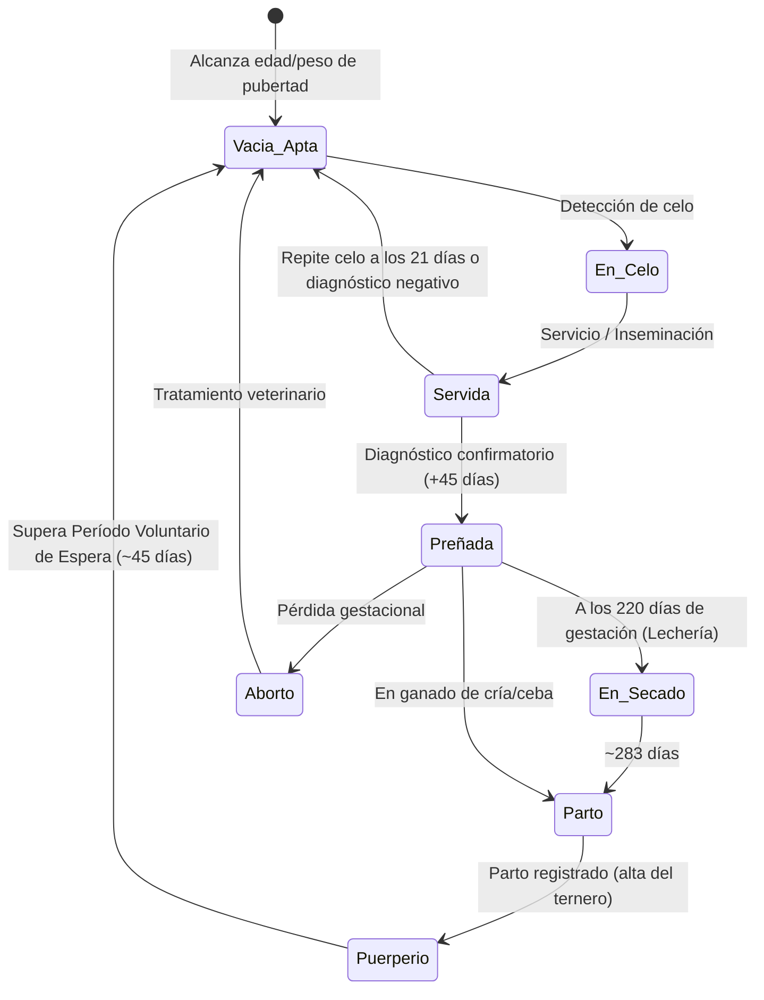

# Skill: Ciclo de Reproducción Bovina

Esta skill proporciona las reglas zootécnicas, biológicas y matemáticas indispensables para desarrollar el módulo de reproducción de la hembra bovina.

## 1. Fisiología Reproductiva Bovina Base

- **Duración del ciclo estral:** Promedio de 21 días (rango normal: 18 a 24 días).
- **Duración del estro (celo activo):** 12 a 18 horas.
- **Regla Universal de Inseminación AM-PM:**
  - Si el celo se detecta en la **Mañana (AM)** -> Se debe inseminar o dar monta en la **Tarde (PM)** del mismo día.
  - Si el celo se detecta en la **Tarde/Noche (PM)** -> Se debe inseminar o dar monta en la **Mañana (AM)** del día siguiente.
- **Período de Gestación:** 
  - *Bos taurus* (razas europeas como Holstein, Angus, Pardo Suizo): ~278 a 282 días.
  - *Bos indicus* (razas cebuinas como Brahman, Nelore, Guzerá): ~288 a 292 días.
  - Promedio estándar general para cálculos en sistema: **283 días**.

## 2. Fórmulas Matemáticas y Cálculos Clave

### A. Fecha Probable de Parto (FPP)
$$\text{FPP} = \text{Fecha del Servicio Fértil} + 283\text{ días}$$

### B. Fecha de Alerta de Secado (Vacas Lecheras)
El secado se realiza aproximadamente 60 días antes de la fecha probable de parto:
$$\text{Fecha de Secado} = \text{FPP} - 60\text{ días} = \text{Fecha de Servicio} + 223\text{ días}$$

### C. Días Abiertos (Días Vacía)
Lapso en días desde el último parto hasta la fecha del servicio que resultó en concepción confirmada:
$$\text{Días Abiertos} = \text{Fecha de Concepción} - \text{Fecha del Último Parto}$$
*Meta zootécnica óptima:* Entre 85 y 110 días. Alerta roja si supera los 150 días.

### D. Intervalo Entre Partos (IEP)
Proyección o cálculo real entre dos partos sucesivos:
$$\text{IEP (meses)} = \frac{\text{Días Abiertos} + 283}{30.4}$$
*Meta zootécnica:* 12 a 13.5 meses (1 ternero por vaca al año).

### E. Servicios por Concepción (S/C)
$$\text{S/C} = \frac{\text{Total de servicios o inseminaciones en el ciclo}}{\text{Total de hembras diagnosticadas preñadas}}$$
*Meta óptima:* Menor o igual a 1.7 servicios por preñez.

---

## 3. Estados Reproductivos de la Hembra

Toda hembra bovina apta debe transitar por la siguiente máquina de estados:

---

## 4. Reglas de Negocio para el Código de Reproducción

1. **Filtrado de candidatos para servicio:**
   - La hembra debe ser `sexo == Hembra`, `estado_actual == Activo`, y no estar diagnosticada como `Preñada`.
2. **Alta Automática del Ternero en el Parto:**
   - Al registrar un parto exitoso con cría viva, el sistema debe crear de forma automática un nuevo registro en la tabla `animales`:
     - `madre_id = id de la vaca que parió`.
     - `padre_id = id del toro o referencia de la pajuela del servicio previo`.
     - `finca_id = finca de la madre`.
     - `fecha_nacimiento = fecha del parto`.
     - `fecha_entrada = fecha del parto`.
     - `origen = Nacido en la finca`.
3. **Manejo de Abortos:**
   - Si se registra un aborto, el estado reproductivo vuelve a `Vacía`, se cancelan las alertas de parto y secado, y se registra la observación sanitaria correspondiente.

